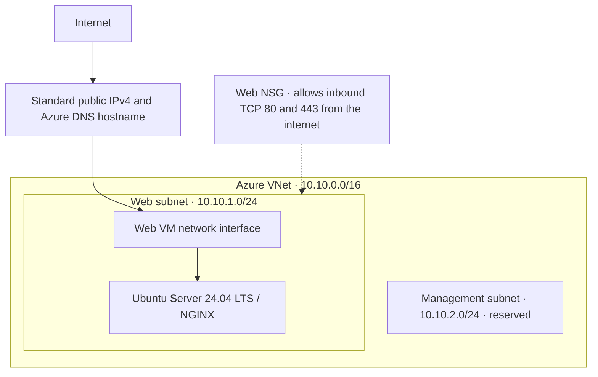

# Azure Secure Web Infrastructure

A hands-on Azure portfolio project that deploys an Ubuntu and NGINX web server
using Bicep and GitHub Actions. It covers virtual networking, HTTPS, monitoring,
email alerts, and deployment using OpenID Connect (OIDC).

## Current status

The infrastructure was deployed and verified in Germany West Central. The VM
is deallocated between lab sessions, so the website may be offline. The
deployment history and verification evidence show what was tested.

## Documentation

- [Deployment and verification](docs/deployment.md)
- [Security decisions](docs/security.md)
- [Pause and cleanup](docs/cleanup.md)

## Architecture

The web subnet uses a Network Security Group (NSG) with no custom rule
allowing SSH from the internet. The VM uses SSH key authentication and
Trusted Launch with Secure Boot and a virtual TPM. Administrative checks
were performed through Azure Run Command.

The management subnet is reserved for future use. Separate subnets by
themselves do not block traffic between workloads.

## Deployment

`infra/main.bicep` creates the Resource Group and calls the network, VM,
monitoring, and alert modules. The network deploys before the VM, and the
VM deploys before its monitoring association and alert. Cloud-init
installs NGINX and writes the demo page on first boot.

The manually triggered GitHub Actions workflow compiles Bicep, signs in to
Azure through OIDC, and runs `what-if`. The default `preview` operation
stops there. Selecting `deploy` also applies the infrastructure, configures
HTTPS, and runs health checks.

The GitHub deployment identity has Contributor access on the project
Resource Group and a custom role for subscription deployment operations.
OIDC uses a federated credential in Microsoft Entra ID, so GitHub needs
no Azure client secret.

## HTTPS

NGINX serves the site using a Let's Encrypt certificate for the Azure-provided
hostname. HTTP redirects to HTTPS. The workflow runs `scripts/enable-https.sh`
after deployment to install certificate tooling if needed and configure NGINX.

GitHub Actions verified certificate trust, HTTP status `200` over HTTPS,
the expected page content, and successful Azure Monitor Agent extension
provisioning. A separate check verified the HTTP `301` redirect. Certificate
renewal passed a dry run. Automatic renewal requires the VM to be running
and reachable.

## Monitoring and alerting

Azure Monitor Agent collects Linux CPU counters every 60 seconds. A Data
Collection Rule sends them to the `Perf` table in Log Analytics. Heartbeat
and CPU records were verified using Kusto Query Language (KQL). The workspace
uses a 30-day default retention period.

The CPU alert uses Azure's separate platform metric, `Percentage CPU`.
It evaluates every minute and fires when the five-minute average exceeds
80%. An email Action Group delivers notifications.

The free-trial subscription blocked the Action Group's sample notification
operation. A real alert triggered at a temporary 0% threshold successfully
delivered a `Sev2 Fired` email. The threshold was restored to 80% and the
rule was disabled after testing.

## Rebuild verification

Workload resources were deleted while the Resource Group, deployment
identity, and RBAC assignments were retained. The first rebuild attempt
created infrastructure but failed when Azure rejected the CPU collection
rule because its destination `Perf` table was unavailable.

The monitoring template now declares `Perf` explicitly and makes the rule
depend on it. A subsequent workflow run completed the rebuild and passed
HTTPS configuration and health checks. Fresh heartbeat records matched the
rebuilt VM's UUID, and a subsequent query returned nine recent CPU samples.

The Log Analytics workspace was soft-deleted, so historical data may have
been recovered. Bootstrapping into a new Resource Group remains untested.

## Evidence

- [Successful rebuild deployment and health checks](https://github.com/AdamF93/azure-secure-web-infrastructure/actions/runs/44131501282)

<!-- Uncomment these links after committing screenshots with matching filenames.

[View all screenshots](docs/images/)
-->

## Repository structure

| Path | Purpose |
| --- | --- |
| `infra/main.bicep` | Subscription entry point for the Resource Group and workload modules |
| `infra/dev.bicepparam` | Development deployment settings |
| `infra/network.bicep` | Virtual network, subnets, and web NSG |
| `infra/vm.bicep` | Public IP, DNS hostname, network interface, Ubuntu VM, and monitoring agent |
| `infra/cloud-init.yaml` | First-boot NGINX installation and demo page |
| `infra/monitoring.bicep` | Log Analytics workspace, `Perf` table, collection rule, and VM association |
| `infra/alerts.bicep` | CPU metric alert and email Action Group |
| `infra/github-federation.json` | GitHub OIDC trust configuration |
| `infra/github-deployment-role.json` | Custom Azure deployment role definition |
| `.github/workflows/azure-auth-test.yml` | Compilation, preview, deployment, HTTPS setup, and health checks |
| `scripts/enable-https.sh` | Certbot installation and NGINX HTTPS configuration |
| `docs/` | Deployment, security, and cleanup guides |

## Cost management

The VM is deallocated between sessions to stop compute charges. Its retained
OS disk and static public IP can still incur charges. The cleanup guide
covers how to remove the lab resources before the Azure trial expires.

## Future improvements

- Add Bicep validation for pull requests.
- Add branch protection and deployment approvals.
- Configure scheduled OS patching.
- Test bootstrap deployment into a new Resource Group.