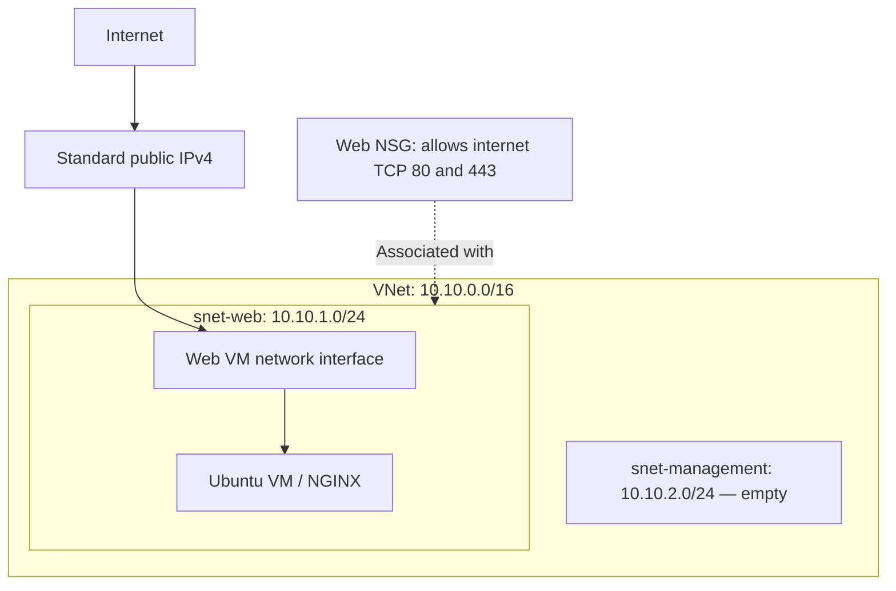

# Azure Secure Web Infrastructure

An Azure portfolio project demonstrating networking, Linux administration
and Infrastructure as Code with Bicep.

## Current status

Core infrastructure has been deployed and tested in Germany West Central.
The Ubuntu VM is currently deallocated to reduce costs, so the website
is offline. Its OS disk and static public IP remain allocated and billable.

## Architecture

Public HTTP access was tested successfully. HTTPS certificates and
NGINX TLS configuration have not yet been implemented.

The management subnet is reserved for future use. Separate subnets alone
do not block communication between workloads.

## Implemented

- Resource Group, VNet, subnets and NSG deployed using Bicep.
- NSG associated with the web subnet.
- Ubuntu Server 24.04 LTS VM with SSH-key authentication.
- No custom rule allowing SSH from the internet.
- Trusted Launch with Secure Boot and virtual TPM enabled.
- NGINX installation and webpage provisioning through cloud-init.
- Server checks performed using Azure Run Command.
- Source code tracked in Git and published to GitHub.
- System-assigned managed identity for the VM.
- Azure Monitor Agent deployed through Bicep.
- Data Collection Rule collecting Linux CPU counters every 60 seconds.
- Log Analytics workspace with 30-day default retention.
- CPU metric alert linked to an email Action Group.
- Modular Bicep deployment through a subscription-scope entry point.
- Development configuration in `infra/dev.bicepparam`.
- GitHub Actions compilation, deployment preview and optional deployment.
- OIDC authentication through a Microsoft Entra application and federated
  credential, without an Azure client secret.
- Project-scoped Contributor access plus a custom role for subscription
  deployment operations.

## Verification completed

- Azure reported successful infrastructure provisioning.
- Cloud-init completed with no reported errors.
- NGINX reported an active service state.
- A local HTTP request returned 200 OK.
- The webpage loaded through the public IP in a browser.
- Azure Monitor Agent heartbeat received in Log Analytics.
- CPU records queried successfully from the Perf table using KQL.
- Real metric alert triggered using a temporary 0% threshold.
- Alert email successfully delivered through the Action Group.
- Alert restored to an 80% threshold and disabled after testing.
- GitHub Actions successfully authenticated to Azure using OIDC.
- The preview operation completed with deployment correctly skipped.
- The deployment operation successfully redeployed the existing environment.

## Repository structure

- `infra/main.bicep` — subscription-scope entry point orchestrating all modules.
- `infra/network.bicep` — VNet, subnets and web NSG.
- `infra/vm.bicep` — public IP, network interface and Ubuntu VM.
- `infra/cloud-init.yaml` — NGINX installation and webpage configuration.
- `infra/monitoring.bicep` — Log Analytics workspace, CPU collection rule
  and association with the VM.
- `infra/alerts.bicep` — CPU metric alert and email Action Group.
- `infra/dev.bicepparam` — development deployment settings.
- `infra/github-federation.json` — GitHub OIDC trust configuration.
- `infra/github-deployment-role.json` — custom deployment role definition.
- `.github/workflows/azure-auth-test.yml` — validation, preview and optional
  deployment workflow.

`infra/main.bicep` creates the Resource Group and orchestrates the network,
VM, monitoring and alert modules. Dependencies ensure networking finishes
before the VM, and the VM finishes before monitoring associations and alerts.

## Cost management

The VM is deallocated between lab sessions to stop compute charges.
The retained disk and public IP continue to incur charges.

Paid resources will be removed before the Azure trial expires.
Bicep source is retained so the environment can be rebuilt.

## Monitoring design

Azure Monitor Agent collects guest CPU measurements every 60 seconds.
The Data Collection Rule routes these records to the Log Analytics
Perf table. Heartbeat and CPU data were verified using KQL.

The CPU alert separately uses Azure's platform metric, Percentage CPU.
It evaluates every minute and triggers when the five-minute average
exceeds 80%.

Email delivery was verified by temporarily lowering the threshold to 0%.
After testing, the threshold was restored to 80% and the rule disabled.

The Action Group test-notification API rejected the free-trial
subscription, but an actual fired alert successfully delivered email.

## Planned improvements

- Verify a complete deployment into an empty environment.
- Add deployment, security and cleanup instructions.
- Configure and verify HTTPS.
- Automate post-deployment health checks.