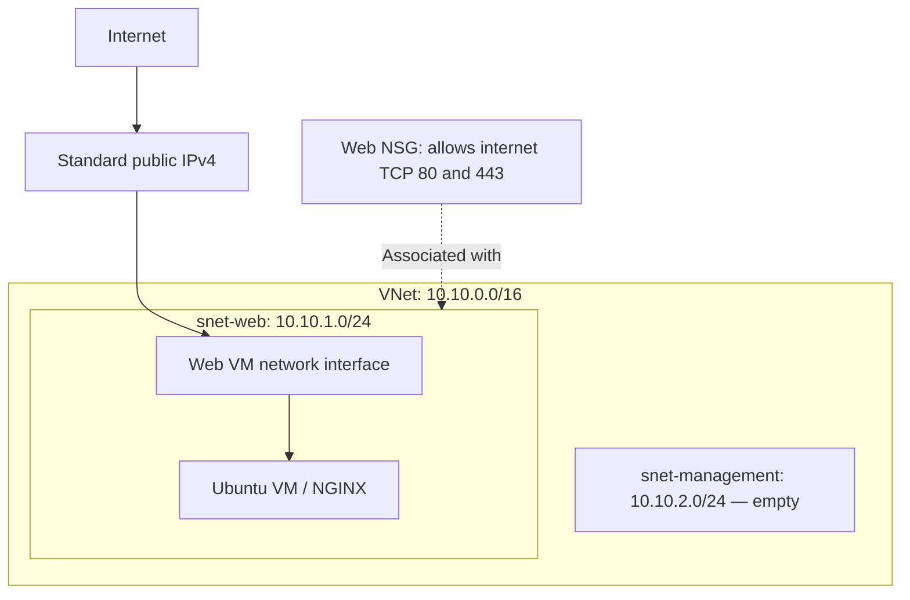

# Azure Secure Web Infrastructure

An Azure portfolio project demonstrating networking, Linux administration
and Infrastructure as Code with Bicep.

## Current status

Core infrastructure has been deployed and tested in Germany West Central.
The Ubuntu VM is currently deallocated to reduce costs, so the website
is offline. Its OS disk and static public IP remain allocated and billable.

## Architecture

Public HTTP access was tested successfully. HTTPS certificates and
NGINX TLS configuration have not yet been implemented.

The management subnet is reserved for future use. Separate subnets alone
do not block communication between workloads.

## Implemented

- Resource Group, VNet, subnets and NSG deployed using Bicep.
- NSG associated with the web subnet.
- Ubuntu Server 24.04 LTS VM with SSH-key authentication.
- No custom rule allowing SSH from the internet.
- Trusted Launch with Secure Boot and virtual TPM enabled.
- NGINX installation and webpage provisioning through cloud-init.
- Server checks performed using Azure Run Command.
- Source code tracked in Git and published to GitHub.

## Verification completed

- Azure reported successful infrastructure provisioning.
- Cloud-init completed with no reported errors.
- NGINX reported an active service state.
- A local HTTP request returned 200 OK.
- The webpage loaded through the public IP in a browser.

## Repository structure

- `infra/main.bicep` — subscription-scope Resource Group deployment.
- `infra/network.bicep` — VNet, subnets and web NSG.
- `infra/vm.bicep` — public IP, network interface and Ubuntu VM.
- `infra/cloud-init.yaml` — NGINX installation and webpage configuration.

The templates are currently deployed separately. A complete deployment
entry point and reusable deployment instructions are planned.

## Cost management

The VM is deallocated between lab sessions to stop compute charges.
The retained disk and public IP continue to incur charges.

Paid resources will be removed before the Azure trial expires.
Bicep source is retained so the environment can be rebuilt.

## Planned improvements

- Azure Monitor, Log Analytics and alerting.
- Explicit least-privilege RBAC configuration.
- Connected Bicep modules and deployment parameters.
- GitHub Actions deployment using OIDC authentication.
- HTTPS configuration.
- Additional architecture, security and troubleshooting documentation.